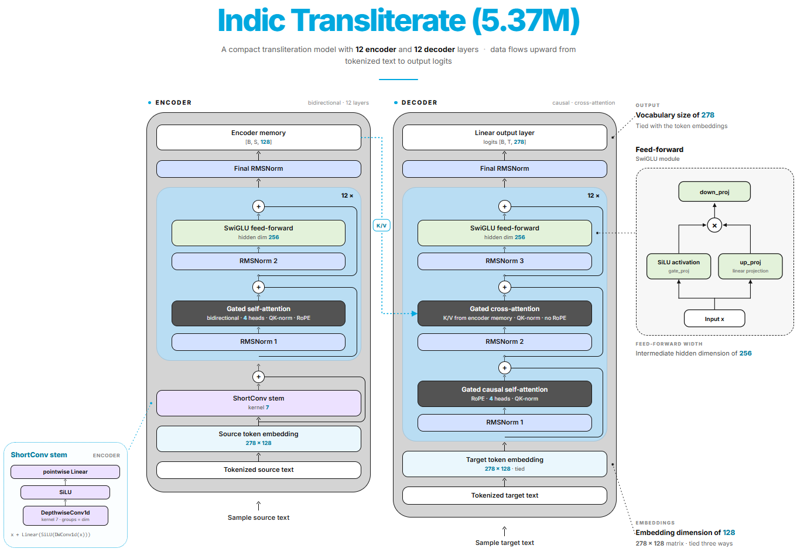

# Indic Transliterate

A compact **5.37M-parameter encoder-decoder transformer** for word-level
transliteration between English and five Indic scripts — Tamil, Hindi, Telugu,
Malayalam, and Kannada.

The whole model ships as **~12 MB of ONNX** and runs on CPU, which makes it
cheap to self-host and fast enough for live, word-by-word typing.

**Live demo:** [harshitv804/Indic-Transliterate](https://huggingface.co/spaces/harshitv804/Indic-Transliterate)
· **Weights:** [harshitv804/Indic-Transliterate](https://huggingface.co/harshitv804/Indic-Transliterate)



## Highlights

| | |
|---|---|
| Parameters | 5.37 M |
| Vocabulary | 278 (byte-level BPE, character granularity) |
| Embedding dim | 128 (4 heads × 32) |
| Encoder / decoder | 12 / 12 layers |
| FFN hidden size | 256 (SwiGLU) |
| ONNX size | **12.8 MB** (fp16 weights, fp32 compute) |
| Training loss | **0.063** |
| Validation loss | **0.155** |
| Decoding | Beam search (beam size 4 by default) |
| Languages | English, Tamil, Hindi, Telugu, Malayalam, Kannada |
| Dataset | [AI4Bharat Aksharantar](https://huggingface.co/datasets/ai4bharat/Aksharantar) |

## Quickstart

### 1. Install

```bash
git clone https://github.com/harshitv804/Indic-Transliterate
cd Indic-Transliterate
pip install -r requirements.txt
```

### 2. Import and run

```python
# Run from the repo root so ``transliterate`` is importable.
from huggingface_hub import snapshot_download

from transliterate import IndicTransliterator

# Download the 12 MB ONNX bundle once; it is then cached by huggingface_hub.
model_dir = snapshot_download(
    "harshitv804/Indic-Transliterate",
    allow_patterns=["onnx_model/*"],
)

tr = IndicTransliterator(f"{model_dir}/onnx_model")

print(tr.translate("How are you?", "en-ta"))   # ஹோவ் அரே யூ?
print(tr.translate("hello", "en-ta"))          # ஹெல்லோ
print(tr.translate("vanakkam", "en-ta"))       # வணக்கம்
print(tr.translate("வணக்கம்", "ta-en"))        # vanakkam
```

If you already have the bundle locally, skip the download:

```python
tr = IndicTransliterator("onnx_model")
```

Decoding options:

```python
tr.translate("How are you?", "en-ta", beam_size=4, length_penalty=1.0)
tr.translate_batch(
    ["How are you?", "Good morning"],
    ["en-ta", "en-ta"],
)
```

### 3. Run the web app

```bash
python app.py          # opens http://127.0.0.1:7860
```

### 4. Run the PyTorch checkpoint

```python
from inference import Transliterator

tr = Transliterator.from_checkpoint("step_105000.pt", device="cuda")
print(tr.translate("How are you?", "en-ta"))
```

```bash
python inference.py --checkpoint step_105000.pt --direction en-ta --text "How are you?"
```

Omit `--text` for an interactive prompt. The PyTorch path needs a CUDA GPU; the
ONNX path above is CPU-only and is what the Space uses.


## Architecture

A pre-norm encoder-decoder transformer. A source sentence is encoded once, then
the decoder emits one token at a time while cross-attending to the encoder
memory.

### Encoder (12 layers, bidirectional)

1. **Source token embedding** — `278 × 128`.
2. **ShortConv stem** — a depthwise convolution (`kernel 7`, `groups = dim`)
   followed by SiLU, a pointwise linear projection, and a residual add. This
   gives every position a local window of neighbouring characters, which helps
   with script-level sound changes.
3. **12 gated self-attention + SwiGLU blocks**, each with two RMSNorms:
   - Gated multi-head self-attention, **4 heads**, **bidirectional** (no causal
     mask), with **QK-norm** and **RoPE** (`theta = 50 000`).
   - SwiGLU feed-forward network with hidden size **256**.
4. **Final RMSNorm**, producing the encoder memory `[B, S, 128]`.

### Decoder (12 layers, causal + cross-attention)

1. **Target token embedding** — `278 × 128`, tied to the source embedding.
2. Each of the **12 blocks** contains three sub-layers, each pre-normed:
   - **Gated causal self-attention** — RoPE, 4 heads, QK-norm.
   - **Gated cross-attention** — Q/K from the decoder, K/V from the encoder
     memory. No RoPE here, since query and key come from different sequences.
     QK-norm still applies.
   - **SwiGLU feed-forward**, hidden size 256.
3. **Final RMSNorm** and a **linear output layer** to `[B, T, 278] vocabulary`
   logits, tied to the token embeddings.

So the `278 × 128` embedding matrix is **tied three ways**: source embedding,
target embedding, and output projection. That keeps the parameter count — and
the ONNX file — small.

### SwiGLU feed-forward

```
gate = SiLU(gate_proj(x))
up   = up_proj(x)
out  = down_proj(gate * up)
```

### ShortConv stem (encoder only)

```
y = x + Linear(SiLU(DepthwiseConv1d(x, kernel=7, groups=dim)))
```

## Tokenizer

A **byte-level BPE tokenizer with a 278-token vocabulary** and no normalizer.
With so few merges it behaves at **character level**, and because it is
byte-level it can never hit an unknown token for any script or punctuation.

The 22 non-byte tokens are:

- `<|bos|>`, `<|eos|>`, `<|pad|>`
- 10 **direction tags** — `<|ta-en|>`, `<|en-ta|>`, `<|hi-en|>`, `<|en-hi|>`,
  `<|te-en|>`, `<|en-te|>`, `<|ml-en|>`, `<|en-ml|>`, `<|kn-en|>`,
  `<|en-kn|>`
- 8 reserved slots

Zero-shot or new language pairs only need a new direction tag and a fine-tune —
the character inventory is already covered.

## Supported directions

| Source | Targets |
|---|---|
| English | Tamil, Hindi, Telugu, Malayalam, Kannada |
| Tamil, Hindi, Telugu, Malayalam, Kannada | English |

Ten directions in total: `ta-en`, `en-ta`, `hi-en`, `en-hi`, `te-en`, `en-te`,
`ml-en`, `en-ml`, `kn-en`, `en-kn`.

## Training

- **Dataset:** [AI4Bharat Aksharantar](https://huggingface.co/datasets/ai4bharat/Aksharantar),
  the large parallel transliteration corpus covering Indic scripts. All five
  languages are mixed into one model, with a direction tag prepended to every
  source sequence.
- **Objective:** token-level cross-entropy, teacher forcing.
- **Final losses:** training **0.063**, validation **0.155**.
- **Optimizer:** AdamW, peak LR `1e-5`, `betas (0.9, 0.95)`, weight decay `0.1`
  (skipped on embeddings, norms and biases), gradient clipping `1.0`.
- **Schedule:** 10k linear warmup, then constant LR.
- **Precision:** bf16; batch size 256; dropout 0.2.
- **Checkpoint used for this release:** `step_105000.pt` (105k optimizer steps).

## Inference

### Word-level decoding, sentence-level API

**The model transliterates one word at a time** — it is trained on single-word
pairs, so feeding it a whole sentence degrades quality. `transliterate.py`
therefore applies a custom word-boundary splitter (regex-style, Unicode-aware:
runs of letters and combining marks versus everything else), translates each
word run on its own, and reassembles the sentence with the original spaces,
punctuation, digits, and newlines untouched.

`en-*` inputs are lowercased first; Indic source text is passed through
unchanged.

### Beam search

Decoding is **beam search only** — no sampling. Beam size defaults to **4**
(`beam_size`, plus `length_penalty`), and the encoder runs once per word while
the decoder batches all beams together.

### ONNX on CPU

`export_onnx.py` exports the trained checkpoint to ONNX:

```bash
python export_onnx.py --checkpoint step_105000.pt --precision fp16
```

The fp16 build stores weights in half precision and **widens them to fp32
in-graph**, so compute stays numerically identical to the PyTorch model while
the bundle shrinks to **12.8 MB** (`encoder.onnx` 5.3 MB + `decoder.onnx`
7.5 MB). `onnx_inference.py` runs it with ONNX Runtime on CPU and needs no
PyTorch at all.

A practical note on speed: these layers are small, so ONNX Runtime thread
oversubscription hurts. The app caps intra-op threads at `min(4, cpu_count)`,
which took per-word latency on a shared container from ~2–7 s down to
~0.1–0.3 s.

## Gradio Space

`app.py` is the live demo app: input on the left, output on the right, a
direction dropdown, and **live word-by-word transliteration** — a word is
translated as soon as it is followed by a space or punctuation, the word
currently being typed stays untouched, and backspacing also removes its
translation. Completed words are cached per `(word, direction)` so retyping a
sentence costs nothing.

Environment variables:

- `MODEL_REPO` — Hugging Face repo to download the ONNX bundle from.
- `BEAM_SIZE` — beam width, default `4`.
- `WORD_CACHE_SIZE` — cached word translations, default `8192`.
- `ONNX_NUM_THREADS` — intra-op threads, default `min(4, cpu_count)`.
- `DIAG_TIMING` — set to `1` to log per-request timings.

## Repository layout

```
app.py                     Gradio Space with live transliteration
transliterate.py           sentence <-> word splitting + public API
onnx_inference.py          ONNX Runtime beam-search decoder
inference.py               PyTorch beam-search decoder + CLI
export_onnx.py             checkpoint -> ONNX (fp32/fp16/bf16/int8/int4)
config.py                  model and training hyperparameters
components/                transformer blocks (attention, SwiGLU, ShortConv, RoPE)
train.py, dataloader.py    training loop and data pipeline
byte_tokenizer/            byte-level BPE tokenizer (278 tokens)
onnx_model/                exported ONNX bundle (downloaded on the Space)
assets/architecture.png    architecture diagram
```

## Limitations

- Transliteration, not translation: it maps sounds and script, so the output is
  phonetic, not semantic.
- Trained on five Indic languages; other scripts are not supported.
- Accuracy is highest on single words and short phrases. Long sentences are
  handled word by word, so cross-word context is not modelled.
- Sanskrit-derived or very rare words may be spelled inconsistently.
- Inputs are lowercased for `en-*` directions, so casing is not preserved.

## License

Apache 2.0 — see [LICENSE](LICENSE).

## Acknowledgements

Trained on the [AI4Bharat Aksharantar](https://huggingface.co/datasets/ai4bharat/Aksharantar)
dataset by AI4Bharat, IIT Madras. Training used
[Liger Kernel](https://github.com/linkedin/Liger-Kernel) RMSNorm/SwiGLU kernels;
inference uses [ONNX Runtime](https://onnxruntime.ai/) and
[Gradio](https://gradio.app/).
